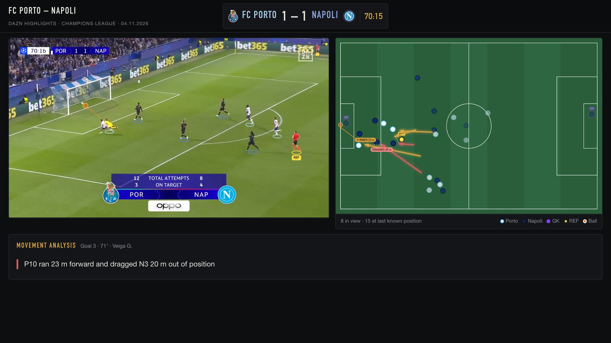
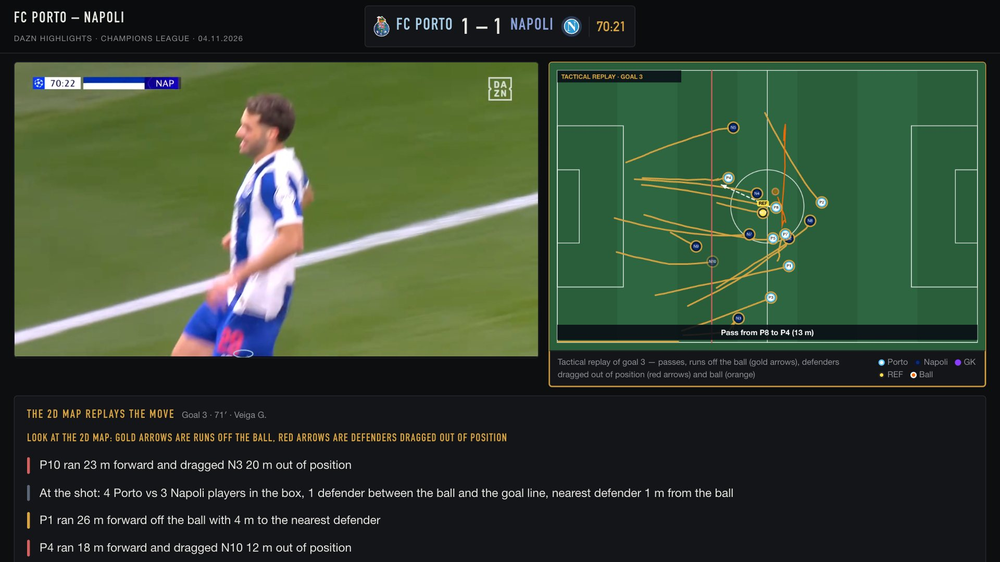

# Football Tracking · FC Porto 4–1 Napoli

A computer-vision system that turns broadcast football video into tactical data, with no manual annotation.
It tracks every player and the ball, calibrates the pitch from its line markings, draws a live 2D map next to
the video, and analyses the movement behind each goal.

Test case: the 10-minute DAZN highlights of FC Porto 4–1 Napoli (Champions League, 04.11.2026).

[Demo video](docs/demo.mp4) (46 s, no sound)

## What it does

- **Players and ball**: YOLO11 detection and ByteTrack tracking, with the tracker reset at every scene cut.
- **Pitch calibration**: a pitch keypoint model, camera-motion propagation and a check of every frame against the
  visible lines. Frames that fail the check are left out of the map instead of guessed.
- **2D tactical map**: 22 player slots, ball, ball carrier and a defensive offside line, smoothed so the map stays
  in step with the video (measured difference of about 0.02 s).
- **Roles and identities**: goalkeepers and referee by position, shirt numbers and names read with OCR where a
  close-up allows it.
- **Movement analysis before each goal**: runs off the ball, defenders dragged out of position, defensive line
  depth and the box at the moment of the shot. The dashboard shows it as gold and red arrows on the 2D map, with a
  written explanation underneath.
- **Dashboard**: static HTML and canvas. Video with labelled players, the map, a timeline of goals and danger
  moments, a tactical replay of each goal during the celebration, and a presentation mode (`?present=1`).

## Honest limits

- Shirt numbers and names are readable only in close-ups. Most players appear as IDs.
- The ball is often hidden. When it is not visible the map keeps its last known position.
- Players out of view are position estimates and are drawn as such.
- Replays, close-ups and fisheye goal cameras cannot be calibrated, so the map does not follow them.
- The movement analysis comes from this tracking, so distances carry its error.

## Pipeline

| Step | Files |
| --- | --- |
| Detection, tracking, calibration, ball | `analyze.py`, `track.py`, `slots.py` |
| Scoreboard OCR and match clock | `timeline.csv`, `halves.py`, `goals.py` |
| Identities | `identify.py`, `jersey_ocr.py`, `identidades.py` |
| Fixes | `gap_fill.py`, `fix_mirror.py` |
| Dashboard data | `build_dashboard.py` |
| Checks | `verificar_sistema.py`, `qa_momentos.py`, `audit_pos.py` |
| Dashboard | `painel/index.html`, `painel/serve.py` |
| Recording the dashboard as video | `record_panel.py` |

`run_destaques.sh` runs the whole chain (about one hour on a Mac). `README.pt.md` has the original notes in
Portuguese, including the measured state of the project.

## Running it

This repository does not include the footage or the model weights.

1. Put your own video in `destaques/resumo.mp4`.
2. Provide the models `analyze.py` expects: the standard Ultralytics `yolo11m.pt`, plus a ball detector
   (`ball_best.pt`) and a pitch keypoint model, both fine-tuned by the author and not included because of size.
3. Install: `ultralytics`, `supervision`, `trackers`, `opencv-python`, `numpy`, `pandas`, `scipy`, `torch`,
   `pyobjc-framework-Vision` (Apple Vision OCR, macOS only).
4. Run `./run_destaques.sh`, then `./painel.sh` and open `http://localhost:8780`.

`match_info.json` and `timeline.csv` describe this particular match and need to be rewritten for another one.

## Credits and notice

- Broadcast footage: DAZN. Analysis, 2D map and dashboard: my own work. No affiliation with the clubs or DAZN.
- Club crests belong to their owners and are shown only to identify the teams.
- Code written with AI assistance (Claude Code) under my direction.
